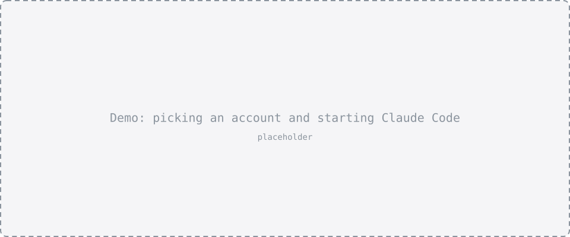
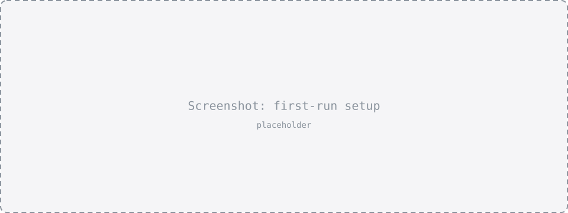

# csw — switch between your Claude subscriptions

Have a personal and a work Claude subscription? `csw` starts Claude Code on the account you choose. Each account keeps its own login, sessions and history, while your settings, `CLAUDE.md`, skills and plugins stay shared. Run sessions on different accounts side by side, and see in Claude's status line which one you're on.



- [Features](#features)
- [Requirements](#requirements)
- [Install](#install)
- [Getting started](#getting-started)
- [Starting Claude](#starting-claude)
- [Managing accounts](#managing-accounts)
- [Status line](#status-line)
- [Configuration](#configuration)
- [How it works](#how-it-works)
- [Safety](#safety)
- [Platforms](#platforms)
- [FAQ](#faq)
- [Uninstall](#uninstall)
- [License](#license)

## Features

- **One command to start Claude on any account:** `csw work`, `csw personal`, or `csw` to pick from a list.
- **A default account**, so plain `csw` goes straight in. One flag sets it, one clears it.
- **Separate logins, shared setup.** Each account has its own login, sessions and history. Settings, `CLAUDE.md`, keybindings, agents, commands, skills, plugins and output styles are shared from your main Claude folder.
- **Always know which account you're on:** the status line shows the account and the email it's signed in with, in colors you choose, per account if you like.
- **Account management:** add, rename, and remove accounts. Removing asks what to do with the data: keep it, move the sessions to your main account, or send everything to the trash.
- **Safe by design:** csw never deletes your main Claude folder, never deletes permanently, and only trashes folders it created.
- **Guided setup:** the first run finds your current login, helps you add more accounts, and offers to install Claude Code if it's missing.
- **macOS, Linux and Windows.**

## Requirements

- [Claude Code](https://code.claude.com/docs/en/setup). If it isn't installed, csw offers to install it with the official installer, and always asks first.
- A Claude subscription for each account (Pro, Max, Team or Enterprise).
- To build from source: [Go](https://go.dev/dl/) 1.25.4 or newer.

## Install

**With Go:**

```sh
go install github.com/OWNER/claude-switch@latest
```

This installs `csw` into `$(go env GOPATH)/bin`; make sure that folder is on your `PATH`.

**From source:**

```sh
git clone https://github.com/OWNER/claude-switch.git
cd claude-switch
go build -o csw .
mv csw ~/.local/bin/        # or any folder on your PATH
```

**Prebuilt binaries:** download the archive for your system from the [Releases](https://github.com/OWNER/claude-switch/releases) page, extract `csw` (`csw.exe` on Windows), and put it on your `PATH`.

Check the install:

```sh
csw version
```

## Getting started

Run `csw`. The first run walks you through setup:



1. **Claude Code.** If it's missing, csw offers the official install methods for your system.
2. **Your main Claude folder.** csw confirms where your current Claude setup lives, usually `~/.claude`. This becomes the *root* account. csw never deletes this folder or anything in it.
3. **Name your current login,** for example `personal`.
4. **Add more accounts,** for example `work`. Each one opens the Claude login in your browser.
5. **Status line.** Optionally show the account and its email at the bottom of Claude Code.

Then start working:

```sh
csw work
```

## Starting Claude


```sh
csw                        # pick an account from a list
csw work                   # start Claude on "work"
csw -a work                # the same, spelled out
csw work "fix the bug"     # start with a prompt
csw work -c                # continue work's latest conversation in this folder
csw work --resume          # pick one of work's past conversations
```

Anything after the account name goes to Claude unchanged, so every Claude flag works: `csw work --model opus`, `csw work -p "summarize this repo"`, and so on.

Before Claude starts, csw prints the account it's using:

```
● work  me@company.com
```

### Default account

```sh
csw work --save            # start "work" and make it the default
csw                        # now starts "work" without asking
csw personal               # another account is still one word away
csw --clear                # forget the default; csw shows the picker again
```

`--save` must come right after the account name: `csw work --save --resume`. The picker marks the default with `● … [default]`.

### Prompts

Quote prompts so they reach Claude as one piece:

```sh
csw "explain this codebase"
csw work "write tests for the parser"
```

Several unquoted words, like `csw fix the bug`, are refused instead of being sent to Claude. They're usually a typo, and Claude would start acting on them right away. A single word goes through as a prompt, unless it's one keystroke away from a command or account name (`csw wrk` asks "Did you mean csw work?"). To send something exactly as typed, put it after `--`:

```sh
csw -- status              # sends the prompt "status" instead of running csw status
```

### Without the picker

In scripts, or anywhere without a terminal, csw needs to know the account up front. Any of these works:

```sh
csw work -p "run the checks"
CSW_ACCOUNT=work csw -p "run the checks"
csw -p "run the checks"    # uses the default account, if one is saved
```

## Managing accounts

| Command | What it does |
|---|---|
| `csw add <name> [--dir <path>] [--no-login]` | Add an account. Its folder defaults to `~/.claude-<name>`; csw shares your settings into it, then opens the login |
| `csw rename [old] [new] [--move]` | Rename an account. Asks for whatever you leave out |
| `csw remove [name]` | Log an account out and remove it. Asks which account, and what to do with its data |
| `csw status [--json \| --plain]` | List every account with its email, plan and login state |
| `csw version` | Show the csw and Claude Code versions |

`csw <command> --help` shows every option with examples.

### Status


`csw status` checks each account's login and shows:

- the email it's signed in with and its plan
- whether it's logged in
- the default account (`●`)
- the root account

It also warns when:

- an account is now signed in with a different email than before (a `/login` inside a session replaces that account's login)
- something in your environment overrides every account's login

`--json` and `--plain` print the same information for scripts.

### Renaming

```sh
csw rename work client            # name only; the folder stays ~/.claude-work
csw rename work client --move     # also renames the folder to ~/.claude-client
```

`--move` asks before doing anything. Sessions, history and settings move with the folder. On macOS, Claude ties an account's login to its folder, so you log in again after the move; on Linux and Windows the login moves with the folder. The root account's folder can't be moved.

### Removing


`csw remove work` logs the account out (only that account) and asks what should happen to its data:

| Choice | Flag | Effect |
|---|---|---|
| Keep everything | `--sessions archive` | Nothing is deleted. Bring it back later with `csw add work --dir ~/.claude-work` |
| Move sessions to the root account | `--sessions move` | Sessions become resumable from your root account (existing files are never overwritten); the rest of the folder goes to the trash |
| Delete everything | `--purge` | The whole folder goes to the trash. You type the account name to confirm |

`-n` / `--dry-run` shows what would happen without changing anything. `-f` / `--force` skips the confirmation, which scripts need.

## Status line


```sh
csw statusline install       # show the account and email in Claude's status line
csw statusline uninstall     # restore your previous status line
csw statusline               # is it installed?
```

Once installed, the bottom of every Claude Code session shows which account it runs on and the email it's signed in with:

```
● work me@company.com
```

The email is read live, so if a `/login` inside a session signs the account in as someone else, the status line shows it right away. Installing edits the `statusLine` entry in your root `settings.json` and keeps a backup. If you already had a status line, it keeps running, and its output appears after csw's. Claude picks up the change in running sessions straight away.

### Colors


```sh
csw statusline colors            # choose: all accounts, or one account
csw statusline colors work       # colors for "work" only
csw statusline colors work --reset
```

The editor shows each element with a color swatch. Pick one to see a palette, and move through it: the preview redraws the status line in the color under the cursor. "Custom" takes any hex code or terminal color number. Give each account its own color, say coral for personal and blue for work, and you can tell them apart at a glance.

## Configuration

csw keeps its settings in `~/.config/csw/config.toml` (or `$XDG_CONFIG_HOME/csw/config.toml`). The commands above manage it for you, but you can edit it by hand:

```toml
root = "~/.claude"            # your main Claude folder: the root account
default = "work"              # started by plain `csw`; empty means show the picker
shared = ["settings.json", "CLAUDE.md", "keybindings.json", "agents", "commands", "skills", "plugins", "output-styles"]

[statusline_colors]           # status line colors for every account
  name = "173"                # account name
  email = "245"               # email

[[accounts]]
  name = "personal"
  dir = "~/.claude"
  email = "me@example.com"

[[accounts]]
  name = "work"
  dir = "~/.claude-work"
  email = "me@company.com"
  [accounts.colors]           # optional: this account's own colors
    name = "#64B5F6"
    email = ""                # empty: use [statusline_colors]
```

- **Colors** are `#RRGGBB`, `#RGB`, or a terminal color number from 0 to 255. Hex colors need a terminal with true color support, which most modern terminals have. An empty or invalid value uses the default.
- **`[statusline_colors]`** always lists every key, so you can see what's adjustable. A key you delete comes back with its default the next time csw runs.
- **`shared`** lists what each account shares from the root folder. Remove an item to give every account its own copy of it.
- **Account names** use letters, digits, `-` and `_`. They can't be csw or Claude command names (`status`, `mcp`, …), so that `csw <name>` always means the account.

### Environment variables

| Variable | Effect |
|---|---|
| `CSW_ACCOUNT` | Account to start, like `-a`. Wins over the default |
| `NO_COLOR` | Plain status line without colors |
| `XDG_CONFIG_HOME` | Where the config folder lives |
| `CLAUDE_CONFIG_DIR` | If set during first-run setup, csw suggests it as the root folder |

## How it works

Claude Code keeps its login, sessions and settings in one folder, `~/.claude` by default, or whatever [`CLAUDE_CONFIG_DIR`](https://code.claude.com/docs/en/settings) points to. Each csw account is its own folder, so each has its own login:

```
~/.claude/                  root account ("personal"): your original setup
~/.claude-work/             "work"
  ├── projects/             work's own sessions
  ├── history.jsonl         work's own history
  ├── settings.json   ──►   ~/.claude/settings.json
  ├── CLAUDE.md       ──►   ~/.claude/CLAUDE.md
  └── skills/         ──►   ~/.claude/skills/
```

`csw work` starts `claude` with `CLAUDE_CONFIG_DIR` pointing at `~/.claude-work`. Shared items are links back to the root folder, so a skill or setting you add once is available on every account. Items you create in the root folder later, like your first custom agent, are linked into each account the next time csw starts it. csw never replaces a file an account already has.

## Safety

csw is careful with your data:

- **Your root folder is never deleted.** csw never deletes `~/.claude`, anything inside it, or any folder that contains it. It writes there only to edit the `statusLine` setting (after making a backup), and to add sessions you chose to move there.
- **Nothing is deleted permanently.** "Deleted" folders go to the Trash on macOS, the desktop Trash on Linux, or the Recycle Bin on Windows. If that isn't possible, for example because the folder is on another disk, csw stops instead.
- **Only folders csw created are trashed.** `csw add` marks the folders it creates with a `.csw-account` file, and csw refuses to trash a folder without it. If you added an existing folder with `--dir` and want csw to be able to trash it, create the marker yourself: `echo work > ~/.claude-work/.csw-account`.
- **Never your home folder or a drive root,** even if the config points there.
- **Only the account you remove is logged out.** Other accounts and plain `claude` stay signed in.
- **Links are never followed** when moving or deleting, so a shared item can't take root files with it.

## Platforms

| | macOS | Linux | Windows |
|---|---|---|---|
| Root folder | `~/.claude` | `~/.claude` | `%USERPROFILE%\.claude` |
| Config | `~/.config/csw/config.toml` | `~/.config/csw/config.toml` | `%USERPROFILE%\.config\csw\config.toml` |
| Trash | `~/.Trash` | `~/.local/share/Trash` | Recycle Bin |
| Shared items | symlinks | symlinks | symlinks, or junctions and hard links when symlinks aren't allowed |

On Windows, symlinks need Developer Mode, so without it csw falls back to junctions for folders and hard links for files.

## FAQ

**Can I use two accounts at the same time?**
Yes. Run `csw personal` in one terminal and `csw work` in another; each session stays on its own account.

**Do API keys, Bedrock or Vertex work?**
No. csw switches between Claude subscriptions, which sign in through the browser. If `ANTHROPIC_API_KEY`, `ANTHROPIC_AUTH_TOKEN` or `CLAUDE_CODE_OAUTH_TOKEN` is set in your shell, or `apiKeyHelper` is in your settings, Claude uses that instead of the account's login on *every* account. csw warns about it when it starts Claude and in `csw status`.

**What happens if I run `/login` inside a session?**
It replaces the login of the account that session runs on. The status line shows the new email, and `csw status` flags the change. Run `csw work auth login` to sign that account back in with the right email.

**Why doesn't csw show usage limits?**
Claude Code's own `/usage` command is the exact source; csw shows the account and email only.

**Where are my sessions?**
In each account's folder, under `projects/`. `csw work --resume` and `csw work -c` see only that account's sessions.

**Can I keep using plain `claude`?**
Yes. Plain `claude` uses your root folder, just as before you installed csw.

## Uninstall

```sh
csw statusline uninstall     # if you installed it: restores your previous status line
rm "$(command -v csw)"
rm -r ~/.config/csw
```

Account folders (`~/.claude-<name>`) stay where they are. Remove them with `csw remove <name>` before uninstalling, or by hand.

## License

MIT. See [LICENSE](LICENSE).
